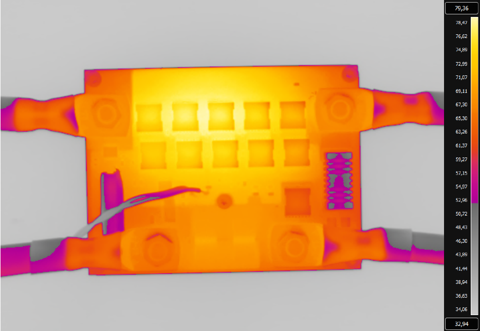
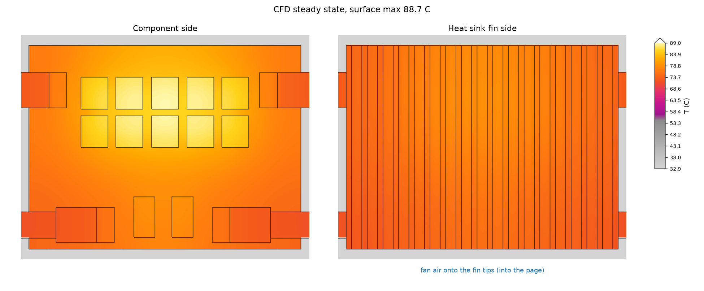

# openfoam-electronics-cooling

[](https://github.com/AWolf81/openfoam-electronics-cooling-skill/actions/workflows/codeql.yml)
[](https://github.com/AWolf81/openfoam-electronics-cooling-skill/releases)
[](LICENSE)

A [Claude Code](https://claude.com/claude-code) skill for thermal simulation of power electronics:
MOSFETs, IGBTs, diodes or regulators on an IMS or PCB, mounted to a finned aluminium heat sink and
cooled by free convection or a fan, with radiation.

You describe the design in one YAML file. The skill then works through these steps:

1. **Losses**, with Rds(on) at temperature.
2. **Hand calculation** with a thermal network. It is the yardstick for the CFD, and sometimes it
   already answers the question.
3. **CFD** of conjugate heat transfer (`chtMultiRegionSimpleFoam`, OpenFOAM v2412 in Docker).
4. **Checks**: energy balance, convergence, and hand calc against CFD.
5. **Report** in Word/PDF with junction temperatures, margins, figures and a warm-up video.

## Install

```bash
git clone --branch v0.1.0 https://github.com/AWolf81/openfoam-electronics-cooling-skill ~/.claude/skills/openfoam-electronics-cooling
bash ~/.claude/skills/openfoam-electronics-cooling/scripts/setup_env.sh
```

The target folder must be named `openfoam-electronics-cooling`, the skill's name. `--branch v0.1.0`
installs the released version; leave it out for the latest `main`.

Requirements:
- Docker. The OpenFOAM image `opencfd/openfoam-default:2412` (about 2.2 GB) is pulled on first run.
- [uv](https://docs.astral.sh/uv/), for the Python environment used by reports and renders.

## Verify your installation

Each release publishes a **package SHA-256** over every file the skill uses (all files except
`README.md`, `CHANGELOG.md`, `.git/`, `.github/`, `.planning/` and Python's `__pycache__`). Check an installed
copy with standard tools only, from the skill's folder (on macOS use `shasum -a 256` for
`sha256sum`):

```bash
cd ~/.claude/skills/openfoam-electronics-cooling
cat VERSION
find . -type f ! -path './.git/*' ! -path './.github/*' ! -path './.planning/*' ! -path '*/__pycache__/*' ! -name '*.pyc' \
  ! -name README.md ! -name CHANGELOG.md -print0 | LC_ALL=C sort -z | xargs -0 sha256sum | sha256sum
```

<!-- package-sha256:start -->
| Version | Package SHA-256 |
|---|---|
| 0.1.0 | `9eff3e2fa99f50819d11e9b57a82c7854805a9d609cefd282b2e44b106a1ad24` |
<!-- package-sha256:end -->

The release notes on [GitHub](https://github.com/AWolf81/openfoam-electronics-cooling-skill/releases) carry the same value, plus a `SHA256SUMS` file to
find which file differs (`sha256sum -c SHA256SUMS`). You can also ask Claude: "Is my
openfoam-electronics-cooling skill the original release?" (the steps are in `SKILL.md`).

## Usage

Start Claude Code in a new folder for your design. The skill writes `case.yaml` and all CFD cases
under `cases/` there.

```bash
mkdir -p ~/thermal/my-power-stage && cd ~/thermal/my-power-stage
claude
```

Then describe the design, with as many numbers as you have:

> Will my power stage overheat? 10 MOSFETs (IAUT300N08S5N011, TOLL) as 5 back-to-back pairs at
> 300 A continuous, 25 °C ambient. Copper-core board, 100 × 75 mm, on a Fischer SK 81 heat sink,
> black anodised. A 12 V PC fan blows along the fins. Do a hand calc first, then run the CFD
> and give me a report.

Datasheets, a reference manual (PDF or link) and the board layout help: Claude reads the values from
them. Anything missing is asked for or marked as an assumption (`# CHECK:` in `case.yaml`).

## Example: Infineon 48 V battery switch at 300 A

The skill was tested on the Infineon reference design R 48V BATT SWITCH10:
[UG-2021-20, *48V Battery Switch Reference Design*](https://www.farnell.com/datasheets/3739859.pdf).
It has 10 back-to-back IAUT300N08S5N011 MOSFETs on a copper-core board and a finned heat sink, cooled
by a low-speed 12 V PC fan 20 cm away. In the user guide's test (section 4.1), the board settles at a
maximum of 80 °C after 30 minutes at 300 A and 25 °C ambient.

**Measurement** (UG Fig. 46, IR image after 30 min at 300 A, © Infineon Technologies):



**Simulation** (CFD steady state, 2.4 m/s fan blowing onto the fin tips, k-ω SST, lugs and 50 mm²
cables, copper losses in the board; IR-style palette):



| Fan (not given in the user guide) | Hottest FET case | Measured board max |
|---|---|---|
| 1.5 m/s onto the fin tips (a low-speed fan) | 99 °C | 80 °C |
| 2.4 m/s onto the fin tips | 86 °C | 80 °C |
| about 2.8 m/s onto the fin tips | about 80 °C | 80 °C |
| 2.4 m/s along the fins | 89 °C (normal mesh) | 80 °C |

**The model matches the measurement at about 2.8 m/s, which is a fit, not a prediction.** The
user guide gives neither the fan speed nor its direction. At 2.4 m/s the model is 6 K hot. At a
truly low fan speed it would be about 19 K hot.

Steps that brought the model from about 21 K to 6 K hot:
- cables sized from their temperature in the IR image (50 mm² instead of 35 mm²): −5.5 K
- turbulent air (k-ω SST) instead of laminar: −3 K, and the air-side energy balance closed
- the fan blowing onto the fins instead of along them: −4 K at the same speed

Checks: solids energy balance within 2 %, and the normal mesh within 1 K of the coarse one.

**Still open:** the simulated warm-up reaches 90 % in about 5 min (with the heat capacity of the lugs and
cables included), while the measurement (UG Fig. 47)
takes about 9 min.

[`assets/example-case.yaml`](assets/example-case.yaml) is the input template.

## Validation: plate-fin heat sink against a published measurement

[`assets/validation-plate-fin.yaml`](assets/validation-plate-fin.yaml) reproduces the experiment in
Kirinčić, Fadiga and Delač, *Experimental–Numerical Investigation of Natural Convection from a
Plate Fin Heat Sink with Correlation Assessment*, Thermo 2025, 5(4), 57
([doi:10.3390/thermo5040057](https://doi.org/10.3390/thermo5040057), CC BY 4.0). It is a bare
aluminium extrusion, 123 × 100 mm with 11 fins (3 × 30 mm, 9 mm gaps), vertical in still air and
heated through its base by a water vessel. The heat flow was measured by calorimetry.

| 9.22 W, ambient 29.02 °C | Base temperature | R sink–air | vs measured |
|---|---|---|---|
| Measurement | 50.0 °C | 2.28 K/W | |
| Paper's CFD (ANSYS Fluent, 4–9 M cells) | | 2.22 K/W | −3 % |
| This skill: hand calc | 50.6 °C | 2.34 K/W | +3 % |
| This skill: CFD, coarse (138 k cells) | 49.8 °C | 2.25 K/W | −1 % |
| This skill: CFD, normal (317 k cells) | 50.0 °C | 2.28 K/W | 0 % |

All checks pass on both meshes (energy balance +1.1 to +1.5 %, settled, hand calc vs CFD −4 to
−5 %). Run with skill v0.1.0 from a fresh install. The YAML header has the commands.

## License

MIT, see [LICENSE](LICENSE). The Infineon IR image in `docs/` is © Infineon Technologies, reproduced from
UG-2021-20 for comparison, and is not covered by the MIT license.
