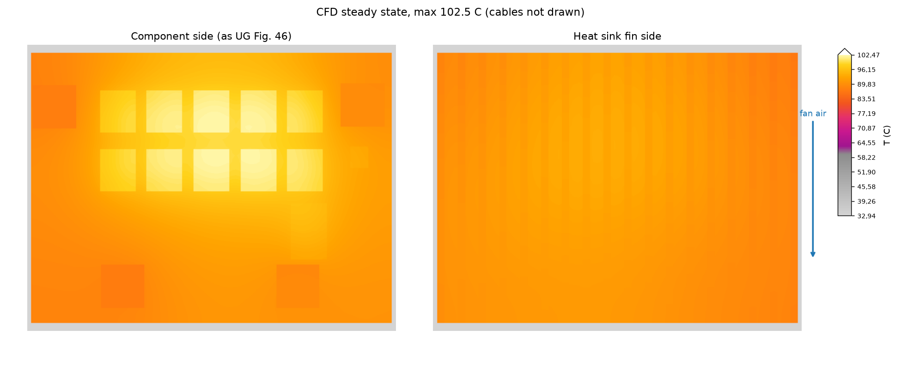

# openfoam-electronics-cooling

A [Claude Code](https://claude.com/claude-code) skill for thermal simulation of power electronics:
MOSFETs, IGBTs, diodes or regulators on an IMS or PCB, mounted to a finned aluminium heat sink and
cooled by free convection or a fan, with radiation.

You describe the design in one YAML file. The skill then works through these steps:

1. **Losses**, with Rds(on) at temperature.
2. **Hand calculation** with a thermal network. It is the yardstick for the CFD, and sometimes it
   already answers the question.
3. **CFD** of conjugate heat transfer (`chtMultiRegionSimpleFoam`, OpenFOAM v2412 in Docker).
4. **Checks**: energy balance, convergence, and hand calc against CFD.
5. **Report** in Word/PDF with junction temperatures, margins, figures and a warm-up video.

## Install

```bash
git clone https://github.com/AWolf81/openfoam-electronics-cooling-skill ~/.claude/skills/openfoam-electronics-cooling
bash ~/.claude/skills/openfoam-electronics-cooling/scripts/setup_env.sh
```

The target folder must be named `openfoam-electronics-cooling`, the skill's name.

Requirements:
- Docker. The OpenFOAM image `opencfd/openfoam-default:2412` (about 2.2 GB) is pulled on first run.
- [uv](https://docs.astral.sh/uv/), for the Python environment used by reports and renders.

Then ask Claude Code something like *"Will 10 MOSFETs at 300 A on this heat sink overheat?"*.

## Example: Infineon 48 V battery switch at 300 A

The skill was tested on the Infineon reference design R 48V BATT SWITCH10:
[UG-2021-20, *48V Battery Switch Reference Design*](https://www.farnell.com/datasheets/3739859.pdf).
It has 10 back-to-back IAUT300N08S5N011 MOSFETs on a copper-core board and a finned heat sink, cooled
by a low-speed 12 V PC fan 20 cm away. In the user guide's test (section 4.1), the board settles at a
maximum of 80 °C after 30 minutes at 300 A and 25 °C ambient.

**Measurement** (UG Fig. 46, IR image after 30 min at 300 A, © Infineon Technologies):


**Simulation** (CFD steady state, 1.0 m/s fan along the fins, terminals and 50 mm² cables, same colour
palette):



| Case | Hottest FET | Measured board max |
|---|---|---|
| CFD, 1.0 m/s (assumed fan speed) | Tj 102 °C | 80 °C |
| CFD, 2.4 m/s (fan speed fitted to the measurement) | case 84 °C | 80 °C |

**The simulation is hotter than the measurement.** The user guide gives neither the fan speed nor the
fan direction, so 1.0 m/s along the fins is an assumption, and at that speed the model is about 20 K
too hot. The 2.4 m/s run comes within 4 K, but only because that speed was fitted to the measurement,
not predicted. More checks are needed to bring the model closer to the real measurement: the
fan speed and how much air reaches the fins, the dry contact between board and heat sink, the cables
(which carry about 15 W out of the board, worth about 19 K on the FETs), and a finer mesh.

What already agrees:
- energy balance of the solids: 0.0 %
- hand calc vs CFD, heat sink rise: −4 %
- warm-up to 90 %: about 8 min simulated, about 9 min measured (UG Fig. 47)

[`assets/example-case.yaml`](assets/example-case.yaml) is the input template.

## License

MIT, see [LICENSE](LICENSE). The Infineon IR image in `docs/` is © Infineon Technologies, reproduced from
UG-2021-20 for comparison, and is not covered by the MIT license.
